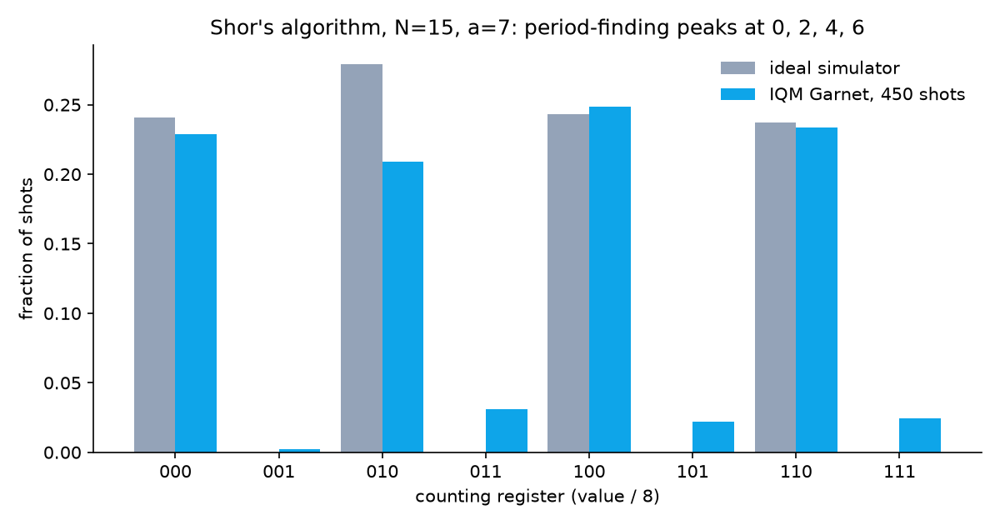

# Shor's Algorithm on a Real Quantum Computer (N = 15)

Shor's algorithm, run on **IQM Garnet**, a 20-qubit superconducting chip rented by the shot through **Amazon Braket**. The chip found the period of 7ˣ mod 15, and a few lines of classical math turned that period into **15 = 3 × 5**.



## Result (real hardware, 2026-10-30)

| Readout | Shots | Means | Factors? |
|---|---:|---|---|
| `000` | 103 | phase 0 | no (trivial) |
| `010` | **94** | phase 1/4, so r = 4 | **3 × 5** |
| `100` | 112 | phase 1/2, so r = 2 | no (7² ≢ 1 mod 15) |
| `110` | **105** | phase 3/4, so r = 4 | **3 × 5** |
| `001` `011` `101` `111` | 36 | noise | — |

**414 of 450 shots (92%)** landed on the four peaks an ideal machine produces. The other 8% is hardware noise.
Raw counts: [`results/qpu_result_light.json`](results/qpu_result_light.json) · task ID: [`results/qpu_task_light.txt`](results/qpu_task_light.txt)

## Honest fine print

- **The circuit was hand-built knowing N = 15.** The modular-multiplication gates are written for 15 and a = 7, as in most small Shor demonstrations. This is a demonstration of the algorithm's structure, not evidence that anything bigger can be factored.
- **The hardware run used the "light" circuit.** The work register starts at 1, so the first controlled-multiply-by-7 reduces to two CNOTs (1 → 7). The "full" circuit (three Fredkin gates) is in the code and checked on the simulator, but it has **not** been run on hardware yet.
- **No error correction.** These are raw physical qubits.
- **450 shots, not 1,000:** the account has a $1 Braket spending limit on Garnet, and 450 shots fit under it.

## How far is this from breaking real encryption?

This chip has 20 qubits. C. Gidney (Google Quantum AI), arXiv:2505.15917 (May 2025), estimates RSA-2048 needs **fewer than 1,000,000 noisy qubits running error correction for under a week**. That's about 50,000 times this chip. Estimates keep falling, which is why the post-quantum migration is happening now. Algorand mainnet, for example, enabled native Falcon-1024 post-quantum account signatures in consensus v42 (go-algorand 5.0).

## Files

```
shor15.py        circuit (full + light), simulator run, classical post-processing
run_qpu.py       submit to IQM Garnet on Amazon Braket (eu-north-1), save raw result
make_video.py    renders the 50-second explainer video from the hardware result
results/         hardware + simulator counts, histogram
video/           shor15_x.mp4 (1080x1080, H.264)
```

## How to run

```bash
uv venv -p 3.12 .venv && uv pip install -p .venv/bin/python amazon-braket-sdk matplotlib pillow
.venv/bin/python shor15.py 1000 --light      # free: local simulator
.venv/bin/python run_qpu.py --light 450      # real chip: needs AWS credentials, costs money
.venv/bin/python make_video.py results/qpu_result_light.json video/shor15_x.mp4   # needs ffmpeg
```

Garnet accepts tasks only during its execution windows (weekdays, UTC). Check `AwsDevice(...).properties.service.executionWindows`.

## Cost

AWS list price, checked 2026-10-30: $0.30 per task + $0.00145 per shot on IQM Garnet.
This run: $0.30 + 450 × $0.00145 = **$0.95**. The local simulator is free.

## How it works

1. Put the 3 counting qubits into superposition (H gates) and set the 4 work qubits to 1.
2. Controlled-multiply the work register by 7, 7² mod 15 = 4, and 7⁴ mod 15 = 1 (identity), so the period of 7ˣ mod 15 gets written into the counting register's phase.
3. Inverse quantum Fourier transform, then measure: the result is k/8 for a phase k/r.
4. Classical part: a continued fraction gives r = 4, then gcd(7² − 1, 15) = 3 and gcd(7² + 1, 15) = 5.

Related: [entanglement-channel-lab](https://github.com/apeirontrade/entanglement-channel-lab). Its Garnet run was cancelled, so this is the first completed hardware result in these repos.

## License

MIT
