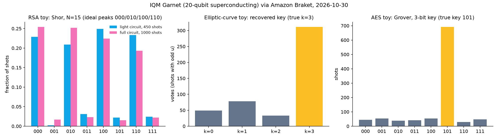

# Crypto Locks vs a Real Quantum Computer

Three quantum attacks on miniature versions of today's crypto, run on **IQM Garnet** (a 20-qubit superconducting chip, rented by the shot through **Amazon Braket**), plus a comparison of how each full-size lock holds up and where Algorand stands.

**All three attacks worked on the toy locks. None of this threatens real 256-bit crypto:** the real targets need hundreds of thousands of qubits running error correction, and this chip has 20. The point is to show the math working and to measure the gap.



## Results (real hardware, 2026-10-30)

| Lock | Attack | Toy version | Real-chip result |
|---|---|---|---|
| **RSA** (banks, websites) | Shor factoring | factor N = 15 | **15 = 3 × 5**: 92% of shots on the ideal peaks (light circuit 414/450; full circuit 923/1000) |
| **Elliptic curves** (Bitcoin, Ethereum, Algorand's Ed25519) | Shor discrete log | mini Ed25519-style curve, 16 points, order-4 subgroup | **secret key recovered (k = 3)**: 311 votes vs 78 for the next guess; 65% of shots valid against a 25% noise baseline |
| **AES-256 / SHA-256** | Grover search | 3-bit key, 8 possibilities | **key 101 found in 2 checks**: 691/1000 shots (69%) against a 12.5% noise baseline |
| **Falcon** (post-quantum, lattices) | none known | nothing to run | — |

Raw counts and task IDs: [`results/`](results/)

## How the full-size locks compare

| Lock | Best known quantum attack | Estimated machine | Verdict |
|---|---|---|---|
| RSA-2048 | Shor | < 1,000,000 noisy qubits, < 1 week (C. Gidney, Google, arXiv:2505.15917, May 2025) | breakable once such machines exist |
| 256-bit elliptic curves | Shor (discrete log) | < 1,200 logical / < 500,000 physical qubits (Google Quantum AI, 2026-03-31; estimate is for 256-bit ECC generally, and Ed25519 is the same size class, my inference) | breakable once such machines exist |
| AES-256 / SHA-256 | Grover | square-root speed-up only: about 2¹²⁸ steps for AES-256 | stays safe |
| Falcon-1024 | none known | — | NIST-selected post-quantum signature |

### Where Algorand stands (checked 2026-10-30)

- **Standard accounts use Ed25519**, an elliptic curve, so they are open to the same Shor attack as Bitcoin's and Ethereum's curve (secp256k1).
- **An Algorand address is its Ed25519 public key** (plus a checksum), so the public key an attacker needs is always visible.
- **Mainnet supports native Falcon-1024 post-quantum accounts:** consensus v42 (go-algorand 5.0), confirmed today from the mainnet node's current protocol version. That is protocol-level support; it doesn't mean every account or wallet uses it, and consensus itself still uses Ed25519.
- For comparison, **Bitcoin's main quantum proposal, BIP-360 (Pay-to-Merkle-Root), is still a Draft** (bitcoin/bips repository, checked today).

## Honest fine print

- **Every lock is toy-sized, and the circuits are hand-built for it.** Anything this small can also be broken classically by trying every key. These runs show the quantum method working; they are not evidence that anything real is breakable today.
- **Shor-15:** the modular-multiplication gates are written for N = 15 and a = 7, as in most small Shor demonstrations. The "light" variant replaces the first controlled multiply with two CNOTs, since the work register starts at 1. Both variants ran on hardware.
- **Elliptic curve:** the oracle is built from **public information only**: the curve, the base point and the public key. Points are labelled by sorted coordinates and "add this point" permutations come from the curve's addition law, so the secret key never enters the circuit. But the subgroup has only 4 elements, so there were only 4 possible keys.
- **Grover:** the lock is hard-wired to recognise key 101. A real AES check would be the whole cipher as a quantum circuit, which needs thousands of error-corrected qubits.
- **No error correction** anywhere: these are raw physical qubits.

## Files

```
shor15.py              Shor N=15 circuit (full + light), simulator run, classical post-processing
toycurve.py            mini Ed25519-style twisted Edwards curve (-x²+y²=1+dx²y², p=13, d=2)
ecdlp.py               Shor discrete-log attack on the toy curve, public-key-only oracle
grover.py              3-bit Grover key search
run_qpu.py             submit Shor-15 to IQM Garnet
qpu.py                 submit the ecdlp / grover experiments to IQM Garnet
plots.py               results/hardware_results.png
vidkit.py              shared video renderer (Pillow -> ffmpeg)
make_video.py          video/shor15_x.mp4   (50 s, Shor-15 only)
make_compare_video.py  video/locks_x.mp4    (71 s, the four-lock comparison)
results/               raw hardware + simulator counts (AWS account number redacted)
```

## How to run

```bash
uv venv -p 3.12 .venv && uv pip install -p .venv/bin/python amazon-braket-sdk matplotlib pillow
.venv/bin/python shor15.py 1000 --light   # simulators: free
.venv/bin/python ecdlp.py 4 3
.venv/bin/python grover.py
.venv/bin/python run_qpu.py --light 450   # real chip: needs AWS credentials, costs money
.venv/bin/python qpu.py ecdlp 1000
.venv/bin/python qpu.py grover 1000
.venv/bin/python plots.py
.venv/bin/python make_compare_video.py video/locks_x.mp4   # needs ffmpeg
```

Garnet accepts tasks only during its execution windows (weekdays, UTC). Check `AwsDevice(...).properties.service.executionWindows`.

## Cost

AWS list price, checked 2026-10-30: $0.30 per task + $0.00145 per shot on IQM Garnet. Four tasks (450 + 3 × 1000 shots) came to **$6.20** in total, matching the Braket spending tracker. The simulators are free.

Related: [entanglement-channel-lab](https://github.com/apeirontrade/entanglement-channel-lab). Its Garnet run was cancelled, so these are the first completed hardware results in these repos.

## License

MIT
